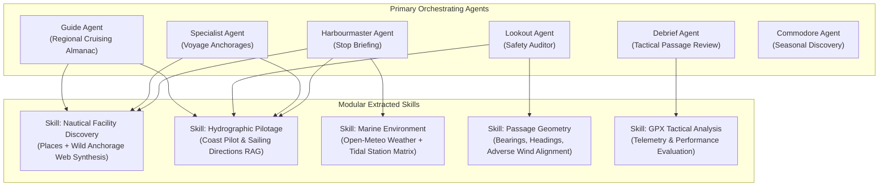

# Engineering Specification & Implementation Plan: Agent Skills Extraction

## Objective

Refactor NavalPlan's AI agent architecture in `code/services/researcher/` from monolithic, prompt-duplicated, "kitchen-sink" tool configurations into modular, reusable **ADK Skills** and focused sub-agents. 

This specification provides a complete, phased implementation roadmap for an autonomous coding agent or engineering team to execute safely with **zero downtime, non-breaking backward compatibility, and isolated evaluations**.

---

## 1. Context & Architectural Assessment

The AI capabilities in NavalPlan reside in `code/services/researcher/`, a dedicated microservice written in Go utilizing the **Google Agent Development Kit (`google.golang.org/adk/v2`)**. The service exposes agents via ADK REST endpoints, A2A (Agent-to-Agent JSON-RPC), and Vertex AI Reasoning Engine streaming endpoints.

The Go backend (`code/app/backend/internal/agent/agent.go`) orchestrates calls via `AgentRunner` calling ADK session endpoints (`/api/apps/{appName}/users/{userId}/sessions/{sessionId}`) and streaming responses via `RunSync` and `RunStreaming`.

### 1.1 Existing Agent Landscape

| Agent Name | Primary Responsibility | Model Temp | Attached Tools | Invocations in Backend |
| :--- | :--- | :--- | :--- | :--- |
| **`harbourmaster`** | Destination briefing (weather, sun, tides, pilot notes, facilities). | `0.25` | All 9 Nautical Tools + Batch Search | `handlers/research.go` (`POST /api/v1/stop/{id}/research`) |
| **`pilot`** | **Dual Role**: (1) Post-voyage tactical GPX debrief; (2) Regional cruising guide. | `0.25` | All 9 Nautical Tools + Batch Search | `handlers/tracks.go` (Debrief) & `handlers/guide.go` (Regional Guide) |
| **`commodore`** | Global seasonal discovery (peak seasons, hidden gems, challenging waters). | `0.25` | All 9 Nautical Tools + Batch Search | `handlers/discovery.go` (`GET /api/v1/discovery/mine`) |
| **`specialist`** | Local pilot for anchorage & facility recommendations across 8 compass sectors. | `0.25` | All 9 Nautical Tools + Batch Search | `handlers/recommendation.go` (`POST /api/v1/voyage/{id}/recommendation`), invoked via `RunStreaming` (all other agents use `RunSync`) |
| **`lookout`** | Maritime safety auditor (weather, tides, adverse wind headings, hazards). | `0.10` | All 9 Nautical Tools (Search excluded) | `handlers/lookout.go` (On stop research & on-demand) |
| **`<name>_search_specialist`** | Per-agent sub-agent wrapping Google Search for grounding and links. One instance is built per parent agent via `createSearchTools` (e.g. `harbourmaster_search_specialist`); it is **not** a single shared instance. | `0.40` | `geminitool.GoogleSearch` | Wrapped as a tool via `agenttool.New` and attached to every agent whose spec sets `includeSearch: true` (currently all except `lookout`) |

---

## 2. Identified Anti-Patterns & Technical Debt

### Anti-Pattern 1: "Kitchen-Sink" Blanket Tool Provisioning
In `internal/agent/agent.go:123-136`, any agent with `includeResearcher: true` receives all 9 tools (`GetTides`, `GetWeather`, `GetSunriseSunset`, `FindPlacesNearby`, `GetSafetyAlerts`, `QuerySailingDirections`, `QueryCoastPilot`, `CalculateHeading`, `FilterGPXData`).
- `commodore` only searches the web for seasonal world destinations, yet its prompt context is burdened with schemas for tidal stations, Open-Meteo forecasts, and GPX smoothing.
- `FilterGPXData` is registered as an ADK LLM tool, but GPX filtering is performed deterministically in Go upon upload (`gpx.FilterGPX(data)` in `tracks.go:51`). No agent prompt instructs the model to call `FilterGPXData`.
- Inflated tool schemas consume unnecessary prompt tokens, increase model latency, and create action-space ambiguity.

### Anti-Pattern 2: The `pilot` "Split Personality"
In `internal/prompt/pilot.md`, the prompt instructions are split into two completely unrelated tasks:
- `TASK TYPE 1: POST-VOYAGE TACTICAL PILOT DEBRIEF`: Evaluates telemetry differences (actual distance vs planned distance, SOG, tacking overhead, leeway, sail trim). It needs zero external tools.
- `TASK TYPE 2: REGIONAL SAILING GUIDE RESEARCH`: Researches regional sailing seasons, hurricane windows, customs/entry, charter operators, and airports. It needs Google Search, Places, and Sailing Directions.
Because both tasks share one agent name (`pilot`), general queries or standalone test scripts (e.g. `scripts/agent_tests/test_sailing_directions.sh`) default to the 10-field Regional Guide JSON schema even when asking a simple hydrographic question.

### Anti-Pattern 3: Duplicated Facility Discovery Prompting
Both `harbourmaster.md` and `specialist.md` contain 60+ lines of identical prompt instructions:
- Parallel queries for `"anchorage"`, `"marina"`, `"yacht club"`, `"mooring"`, `"diesel fuel dock"`, `"cove bay harbor"`, `"boat launch ramp"`.
- Metric conversion mandates: *"You MUST convert the requested radius to METERS when calling 'FindPlacesNearby' (1 NM = 1852 meters, capped at max 50000 meters)."*
- Web search fallback directives: how to extract wild anchorages from search snippets because Google Places lacks natural anchorages.

### Anti-Pattern 4: Overloaded Deterministic Computation in `lookout`
In `lookout.md`, the LLM is tasked with performing strict numeric threshold comparisons (e.g. `wind > 33 kts = Danger`, `wave > 13 ft = Danger`, `tide range > 10 ft = Warning`, `wind within 45° of course & speed > 15 kts = Warning`). 
While `lookout` excels at qualitative reasoning (synthesizing bridge clearances, entrance bar hazards, and local currents from Sailing Directions), consuming model inference tokens on basic arithmetic comparisons is slow, expensive, and fragile.

### Anti-Pattern 5: Orphaned & Stubbed `GetSafetyAlerts`
`GetSafetyAlerts` (`FetchSafetyAlerts` in `internal/tool/adapters.go:293`) is registered as an ADK function tool and exposed over MCP, with the stated goal of *"extracting active global navigational warnings and localized security alerts"* (returns `active_hazards[]` + `security_level`). Its goal is **not currently being achieved**, on two counts:
- **Orphaned**: no agent prompt references `GetSafetyAlerts`, so the `lookout` LLM never invokes it. The `safety_alerts` column populated by `handlers/lookout.go:303` (`UpsertSafetyAlerts`) is the lookout agent's own *synthesized* JSON alert output — it is unrelated to this tool's navigational-warnings feed.
- **Stubbed**: `FetchSafetyAlerts` returns hard-coded mock data (always `["Shoaling reported near channel marker 4"]` / `"Normal"`), per its own comment *"we don't have a safety tool yet."*

This tool is navigationally important and MUST be preserved. Milestones 1 and 5 below keep it on `lookout` and add the work required to make its goal actually occur (prompt wiring + a real data source), rather than silently dropping it.

---

## 3. Target Architecture & Domain Skills

The target architecture extracts cross-cutting capabilities into **ADK Skills** (modular sub-agents wrapped via `agenttool.New` or focused toolsets) and decouples overloaded agents into single-responsibility units:



### 3.1 Skill Definition Contracts

#### Skill 1: `NauticalFacilityDiscovery` (Sub-Agent: `facility_discovery`)
* **Purpose**: Searches, validates, dedupes, and geocodes marine infrastructure within a defined geographical radius.
* **Encapsulates**:
  - Distance unit conversion (NM / Miles to Meters, 50,000m max ceiling).
  - Parallel Places API queries across marina, anchorage, mooring, yacht club, fuel dock categories.
  - Web search fallback for wild, natural, or unofficial anchorages missing from commercial POI databases.
  - Compass sector distribution sampling for radii > 27 NM.
* **Interface Input Schema**:
  ```json
  {
    "latitude": 41.4901,
    "longitude": -71.3128,
    "radius_nm": 10.0,
    "trip_type": "overnight" // "overnight" | "day_trip"
  }
  ```
* **Output Schema**:
  ```json
  {
    "anchorages": [{"name": "string", "latitude": 0.0, "longitude": 0.0, "shelter": "string", "holding": "string", "is_wild": true}],
    "moorings": [{"name": "string", "latitude": 0.0, "longitude": 0.0}],
    "marinas": [{"name": "string", "latitude": 0.0, "longitude": 0.0, "vhf_channel": "string", "phone": "string"}],
    "fuel_stations": [{"name": "string", "latitude": 0.0, "longitude": 0.0, "diesel": true, "gasoline": true}]
  }
  ```

#### Skill 2: `HydrographicPilotage` (Sub-Agent: `hydrographic_pilot`)
* **Purpose**: Queries NOAA Coast Pilot (US) and NGA Sailing Directions (International) for official hydrographic navigational advice.
* **Encapsulates**:
  - Automated territory routing (`territory: "us" | "international" | "all"`).
  - Query construction for controlling depths, bridge vertical clearances, tidal rips, speed limits, and anchorage regulations.
  - Consistent citation formatting (e.g. `"NOAA Coast Pilot 2, Chapter 8"`).
* **Interface Input Schema**:
  ```json
  {
    "location_name": "Cape Cod Canal",
    "latitude": 41.7417,
    "longitude": -70.5667,
    "focus_areas": ["channel_depths", "bridge_clearances", "currents", "regulations"]
  }
  ```

#### Skill 3: `TacticalPassageDebrief` (Dedicated Agent: `debrief`)
* **Purpose**: Performs post-voyage after-action review comparing recorded GPX track telemetry against planned passage routes.
* **Encapsulates**:
  - Distance delta, duration delta, and Speed Over Ground (SOG) analysis.
  - Evaluation of windward work, tacking overhead, leeway, and tidal current effects.
  - Generates concise tactical insights without external API tool dependencies.

---

## 4. Phased Implementation Roadmap

To ensure continuous system operation, the implementation must proceed in five self-contained milestones.

### Milestone 1: Fine-Grained Tool Scoping (Zero Risk)
**Goal**: Stop blanket tool assignment in `code/services/researcher/internal/agent/agent.go`.

* [ ] Replace `includeResearcher bool` in `type spec` with explicit tool bundle identifiers or a slice of needed tools:
  ```go
  type spec struct {
      name        string
      description string
      instruction string
      temperature float32
      toolNames   []string // e.g. ["weather", "tides", "places", "sailing_directions"]
  }
  ```
* [ ] Assign only relevant tools per agent:
  - `commodore`: Google Search only (remove all 9 nautical tools).
  - `lookout`: `GetTides`, `GetWeather`, `GetSunriseSunset`, `QuerySailingDirections`, `QueryCoastPilot`, `CalculateHeading`, **`GetSafetyAlerts`** (remove Places and GPX filter only). `GetSafetyAlerts` is retained deliberately — it is the safety auditor's navigational-warnings feed (see Anti-Pattern 5); do **not** drop it.
  - `specialist`: `FindPlacesNearby`, `QuerySailingDirections`, `QueryCoastPilot`, Batch Search (remove Weather, Tides, Sun, GPX filter).
* [ ] Remove `FilterGPXData` from LLM tool definitions (it is handled in Go during upload).
* [ ] Run `make test` and verify agent startup.

### Milestone 2: Decouple `pilot` into `debrief` and `pilot`
**Goal**: Eliminate the dual-personality prompt and clarify agent responsibilities.

* [ ] Create `code/services/researcher/internal/prompt/debrief.md` containing only `TASK TYPE 1` instructions.
* [ ] Update `code/services/researcher/internal/prompt/pilot.md` to contain only `TASK TYPE 2` (Regional Sailing Guide) instructions.
* [ ] Register `debrief` as a first-class agent in `agent.go`:
  ```go
  const (
      Harbourmaster = "harbourmaster"
      Pilot         = "pilot"
      Debrief       = "debrief"
      Commodore     = "commodore"
      Specialist    = "specialist"
      Lookout       = "lookout"
  )
  ```
* [ ] Attach zero tools to `debrief` (it evaluates telemetry passed directly in the prompt).
* [ ] Maintain backward-compatibility: If `pilot` receives a prompt containing `"post-voyage tactical pilot debrief"`, delegate or handle gracefully.
* [ ] Update `code/app/backend/internal/server/handlers/tracks.go:974` to call `"debrief"` instead of `"pilot"`.
* [ ] Add eval dataset: `code/services/researcher/eval/debrief/debrief.dataset.json`.

### Milestone 3: Extract `NauticalFacilityDiscovery` Sub-Agent Skill
**Goal**: Deduplicate marine facility and anchorage search across `harbourmaster` and `specialist`.

* [ ] Create `code/services/researcher/internal/prompt/facility_discovery.md`.
* [ ] Implement `createFacilityDiscoveryAgent(ctx, cfg)` in `internal/agent/agent.go`.
* [ ] Provide `facility_discovery` with `FindPlacesNearby` and `geminitool.GoogleSearch`.
* [ ] Wrap the sub-agent as an ADK tool using `agenttool.New(facilityAgent, nil)`.
* [ ] Update `harbourmaster.md` and `specialist.md`: replace repetitive multi-query search instructions with a single delegated call to the facility discovery tool.
* [ ] Add unit tests and an eval dataset for facility discovery.
* [ ] **Streaming caution:** `specialist` is invoked via `RunStreaming` (`handlers/recommendation.go:378`), unlike the other agents that use `RunSync`. Verify that delegating to the `facility_discovery` sub-agent tool mid-stream does not break the streamed response (sub-agent tool calls must resolve before the parent emits its final JSON).

### Milestone 4: Extract `HydrographicPilotage` Sub-Agent Skill
**Goal**: Standardize RAG retrieval from Coast Pilot and Sailing Directions.

* [ ] Create `code/services/researcher/internal/prompt/hydrographic_pilot.md`.
* [ ] Implement `createHydrographicPilotAgent(ctx, cfg)` with `QuerySailingDirections` and `QueryCoastPilot`.
* [ ] Wrap as an ADK tool via `agenttool.New` and attach to `harbourmaster`, `lookout`, and `specialist`.
* [ ] Standardize citation formatting and query dispatching across all agents.
* [ ] Update test scripts `test_sailing_directions.sh` and `test_coast_pilot.sh` to target this specialized skill.

### Milestone 5: Hybridize `lookout` with Deterministic Go Pre-Validation
**Goal**: Relieve the `lookout` LLM of trivial numeric threshold calculations and focus tokens on semantic hazard interpretation.

* [ ] Create a Go validator helper `code/app/backend/internal/safety/validator.go` (or in `researcher/internal/safety/`).
* [ ] Move deterministic checks into Go:
  - Wind speed > 33 kts (`danger`), 18–33 kts (`warning`).
  - Wave height > 13 ft (`danger`), 7–13 ft (`warning`).
  - Wave period <= 10s with height > 10 ft (`danger`).
  - Tidal range > 10 ft (`warning`).
  - Adverse headwind: course bearing vs wind direction <= 45° with speed > 15 kts (`warning`).
* [ ] Feed the deterministic rule output directly into the `lookout` prompt context as pre-evaluated constraints.
* [ ] Refactor `lookout.md` prompt: instruct the LLM to focus purely on **qualitative hazard synthesis** from Coast Pilot notes (e.g. overhead power cables, shoaling channels, inlet bars, traffic schemes).
* [ ] **Activate `GetSafetyAlerts` (make its goal occur — see Anti-Pattern 5):**
  - Wire `GetSafetyAlerts` into `lookout.md` so the LLM actually calls it and folds its `active_hazards` and `security_level` into the safety audit (today no prompt references it, so it is never invoked).
  - Replace the stub `FetchSafetyAlerts` (`adapters.go:293`), which returns hard-coded mock data, with a real navigational-warnings source (e.g. NAVTEX / USCG Local Notice to Mariners / MSI feed). Until a live source exists, have it return an explicit "no data available" response rather than canned hazards, so the audit is never seeded with a fake "Shoaling reported near channel marker 4".
  - Keep `GetSafetyAlerts` on the `lookout` tool bundle from Milestone 1.

---

## 5. Verification & Quality Gates

Each milestone must pass the following verification gates before proceeding:

1. **Static Analysis & Formatting**:
   - `goimports -w` executed on all modified Go files.
   - `go mod tidy` in both `code/app/backend` and `code/services/researcher`.
   - No double spacing in Go code.
2. **Backend Unit & Integration Tests**:
   - `make test` from repository root must pass completely.
3. **Shell Script Smoke Tests**:
   - `scripts/agent_tests/test_researcher_agent.sh`
   - `scripts/agent_tests/test_guide_agent.sh`
   - `scripts/agent_tests/test_navigator_agent.sh`
   - `scripts/agent_tests/test_discovery_agent.sh`
   - `scripts/agent_tests/test_coast_pilot.sh`
   - `scripts/agent_tests/test_sailing_directions.sh`
4. **ADK Agent Evaluation**:
   - `make test-all` or `google-adk` eval suite execution against `code/services/researcher/eval/` to verify no regression in accuracy or rubric scores.

