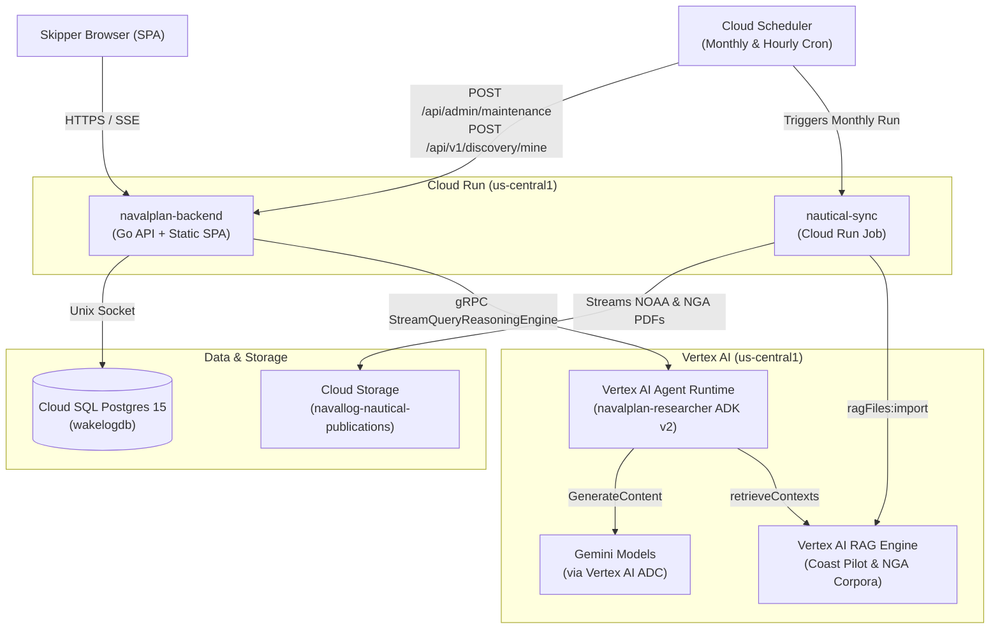

# NavalPlan — Google Cloud Architecture Review & Recommendations

**Date:** October 14, 2026  
**Repository:** [`github.com/tpryan/navalplan`](https://github.com/tpryan/navalplan)  
**GCP Project:** `navallog` (`us-central1`)

---

## Executive Summary

The core application architecture of **NavalPlan** is **clean, pragmatic, and well-suited to its workload**. In live production, the footprint is actually quite lean:
1. **`navalplan-backend` (Cloud Run Service):** Serves both the compiled Vanilla JS/Vite SPA (`static.min`) and the Go REST API.
2. **`navalplan-researcher` (Vertex AI Agent Runtime / Reasoning Engine):** Runs the ADK v2 Go multi-agent system (`projects/70159681032/locations/us-central1/reasoningEngines/1643463669536784384`).
3. **`nautical-sync` (Cloud Run Job):** Monthly batch job triggered by Cloud Scheduler that streams NOAA Coast Pilot and NGA Sailing Directions PDFs to Cloud Storage and imports them into **Vertex AI RAG Engine** corpora.
4. **`wakelogdb` (Cloud SQL for PostgreSQL 15):** Relational persistence accessed via Unix socket.

**Where the "too many sub-bits" feeling comes from:**  
While your **live** GCP environment has moved to Vertex AI Agent Runtime, the **repository (`Makefile`, `.cloudbuild/`, `scripts/`, and Go client code)** still carries the scaffolding from earlier architectural iterations—including a legacy Cloud Run deployment path for the agent, four simultaneous wire protocols on the researcher service, twelve Secret Manager mounts (several of which are non-sensitive config), three database migration mechanisms, and `gcr.io` vs. Artifact Registry drift.

---

## 1. What Is Architected Well (Keep As-Is)

* **Single-Container Frontend + Backend (`navalplan-backend` on Cloud Run):**  
  Compiling `code/app/frontend` into `code/app/backend/static.min` during the build and serving static assets alongside `/api/v1/*` from one Go binary eliminates CORS configuration, separate CDN/hosting buckets, and extra Cloud Run services.
* **Batch RAG Sync via Cloud Run Jobs (`code/jobs/nautical-sync`):**  
  Using `Cloud Scheduler` → `Cloud Run Job` (`nautical-sync`) → `Cloud Storage` → `Vertex AI RAG Engine` (`ragFiles:import`) is the right serverless pattern for long-running PDF downloads and chunking/embedding jobs (`--task-timeout=3600s`).
* **ADK Sub-Agent Tool Isolation (`code/services/researcher/internal/agent/agent.go`):**  
  Wrapping `FindPlacesNearby` + Google Search inside `facility_discovery` and isolating the two Vertex AI RAG corpora (`coast-pilot-corpus`, `nga-sailing-directions-corpus`) inside `hydrographic_pilot` cleanly avoids Gemini's restriction on mixing grounded Google Search with custom function declarations in the same request.
* **Structured Cloud Logging & Cloud Trace (`internal/telemetry`):**  
  Mapping `slog.NewJSONHandler` attributes to `severity`, `logging.googleapis.com/trace`, and `logging.googleapis.com/spanId` alongside OpenTelemetry batch export gives end-to-end trace correlation across the backend and agent runtime.

---

## 2. Priority Recommendations (Simplification & Cleanup)

### Priority 1: Remove Legacy Cloud Run Agent Scaffolding (Or Consolidate Runtime Paths)

Your live environment runs `navalplan-researcher` solely on **Vertex AI Agent Runtime (Reasoning Engine)** via `make deploy-agent-runtime`, and there is no `navalplan-researcher` Cloud Run service running. However, the repository still maintains both worlds:

* **`.cloudbuild/cloudbuild-agent.yaml` (Steps 1–3):** Still builds a Docker container, pushes to `gcr.io/${PROJECT_ID}/navalplan-researcher`, and runs `gcloud run deploy navalplan-researcher` before Step 4 runs `agents-cli deploy --deployment-target=agent_runtime`. Running `make deploy-agent` will unexpectedly recreate the Cloud Run service.
* **`Makefile` (`register-registry`) & `scripts/register_registry.sh`:** Still query `gcloud run services describe navalplan-researcher` to resolve `NAVALPLAN_RESEARCHER_URL`.
* **Backend Dual Client (`code/app/backend/internal/agent/`):** Maintains both `agent.go` (HTTP/SSE client with Cloud Run ID token auth) and `reasoning_engine.go` (gRPC `StreamQueryReasoningEngine` client).
* **`scripts/deploy_mesh.sh` & `code/services/researcher/Dockerfile`:** Only apply to Cloud Run revisions/traffic splitting.

**Recommendation:**
1. Remove Steps 1–3 (`docker build`, `docker push`, `gcloud run deploy`) from `.cloudbuild/cloudbuild-agent.yaml` so CI/CD only runs ADK evaluations (Step 0) and deploys to **Vertex AI Agent Runtime** (Step 4).
2. Remove `scripts/deploy_mesh.sh` and retire `make deploy-agent` in favor of a single `make deploy-agent` target that targets Agent Runtime.
3. Keep the HTTP client in `code/app/backend/internal/agent/agent.go` **only** for `localhost:8081` local development (`make dev`), and use `ReasoningEngineRunner` for production.

---

### Priority 2: Trim Redundant Wire Protocols in `code/services/researcher`

Currently, `code/services/researcher/internal/server/server.go` exposes **four separate protocol surfaces** on the same service:
1. `/api/*` — Standard ADK REST/SSE server (`adkrest.NewServer`) used by local dev (`make dev`).
2. `/api/reasoning_engine` & `/api/stream_reasoning_engine` — Used by Vertex AI Agent Runtime (`ReasoningEngine`).
3. `/invoke` & `/invoke/{agent}` — **A2A JSON-RPC + Agent Cards** (`adka2a` / `a2asrv`).
4. `/mcp/tools` — **Custom MCP JSON-RPC handler** (`internal/mcp/mcp.go`).

**Why this adds maintenance friction:**
* Your agents do **not** call `/mcp/tools`—they bind Go tools directly in-process via `nautical.AsTools()`. Meanwhile, `internal/mcp/mcp.go` manually hardcodes JSON-RPC tool schemas that duplicate the struct tags in `internal/tool/*.go`.
* The `/invoke/*` A2A endpoints are only used locally by `eval_a2a_shim.py` during `make eval-*` and by `make register-registry`.

**Recommendation:**
* **If you do not actively demo external agents discovering NavalPlan via Agent Registry:** Remove `internal/mcp/mcp.go`, `mcp_tool_spec.json`, `scripts/register_registry.sh`, and the `register-*` targets in `Makefile`.
* **If you DO want MCP + A2A for Gemini Enterprise / Agent Registry demos:** Keep them, but generate the `tools/list` schema in `internal/mcp/mcp.go` dynamically from `nautical.AsTools()` instead of maintaining a second hardcoded copy of every tool's input schema.

---

### Priority 3: Move Non-Sensitive Config Out of Secret Manager

In `.cloudbuild/cloudbuild.yaml` and `scripts/setup_secrets.sh`, `navalplan-backend` mounts **12 secrets** from Google Cloud Secret Manager, 5 of which are plain configuration values rather than secrets:

| Currently in Secret Manager | Should Be | Rationale |
| :--- | :--- | :--- |
| `NAVALPLAN_DB_PASS` | **Secret Manager** | Database password |
| `NAVALPLAN_OA_SECRET` | **Secret Manager** | OAuth client secret |
| `NAVALPLAN_SYSTEM_KEY` | **Secret Manager** | Internal scheduler/admin bearer token |
| `NAVALPLAN_FRONTEND_MAPS_API_KEY` | **Secret Manager** | API key (injected at build & runtime) |
| `NAVALPLAN_BACKEND_MAPS_API_KEY` | **Secret Manager** | Backend Maps/Places API key |
| `NAVALPLAN_DB_USER` | `--set-env-vars` | Non-secret username (`navalplan_user`) |
| `NAVALPLAN_DB_PORT` | `--set-env-vars` | Non-secret port (`5432`) |
| `NAVALPLAN_DB_MODE` | `--set-env-vars` | Non-secret SSL mode (`disable` over Unix socket) |
| `NAVALPLAN_DB_SOCKET` | `--set-env-vars` | Non-secret Cloud SQL socket path (`/cloudsql/...`) |
| `NAVALPLAN_AGENT_URL` | `--set-env-vars` | Reasoning Engine resource name (`projects/.../reasoningEngines/...`) |
| `NAVALPLAN_MAP_ID` | `--set-env-vars` | Public Google Maps Vector Map style ID |
| `NAVALPLAN_OA_CLIENT` | `--set-env-vars` | Public OAuth Client ID (visible in browser redirect URLs) |

**Recommendation:**
* Move the 7 non-secret items from `--set-secrets` to `--set-env-vars` in `.cloudbuild/cloudbuild.yaml` and remove them from `scripts/setup_secrets.sh`.
* Add `--add-cloudsql-instances=${PROJECT_ID}:us-central1:wakelogdb` explicitly to the `gcloud run deploy navalplan-backend` step in `.cloudbuild/cloudbuild.yaml` so the Cloud SQL Unix socket mount is declarative in CI/CD.

---

### Priority 4: Switch `researcher` from `GEMINI_API_KEY` to Vertex AI ADC in Production

In `code/services/researcher/internal/config/config.go` (lines 1380–1389), the service requires `GEMINI_API_KEY` at startup and fails if it is not set, even though `code/services/researcher/internal/agent/agent.go` (lines 1377–1386) already supports Vertex AI (`GOOGLE_GENAI_USE_VERTEXAI=true`).

**Recommendation:**
* In `code/services/researcher/internal/config/config.go`, only require `GEMINI_API_KEY` when `GOOGLE_GENAI_USE_VERTEXAI != "true"`.
* In `make deploy-agent-runtime` and `.cloudbuild/cloudbuild-agent.yaml`, set `GOOGLE_GENAI_USE_VERTEXAI=true` and `GOOGLE_CLOUD_LOCATION=us-central1`, and drop the `GEMINI_API_KEY=NAVALPLAN_GEMINI_KEY` secret requirement in production. This consolidates all LLM calls, RAG queries, and Reasoning Engine execution onto the service account's native Vertex AI IAM credentials and quota.

---

### Priority 5: Standardize on One Database Migration Path

The repository currently supports **three different ways** to mutate the production Cloud SQL schema:
1. **`.cloudbuild/cloudbuild-migrate.yaml`:** Cloud Build job running `cloud-sql-proxy` + `golang-migrate`.
2. **`make migrate-prod`:** Local `cloud-sql-proxy` + local `golang-migrate` binary.
3. **`make deploy-sql` & `make migrate-prod-gcs`:** Copies raw `.sql` files to `gs://navallog-system` and runs `gcloud sql import sql`.

**Recommendation:**
* **Delete `make deploy-sql` and `make migrate-prod-gcs`** from `Makefile`. Mixing `gcloud sql import sql` with `golang-migrate` bypasses the `schema_migrations` tracking table and causes dirty-version drift (requiring `migrate-prod-force`).
* Standardize on `golang-migrate` (via `.cloudbuild/cloudbuild-migrate.yaml` for CI/CD and `make migrate-prod` for operator CLI use).
* If `gs://navallog-system` is only used for SQL file staging and `eval_results`, move `eval_results` to your logging/artifacts bucket and delete `gs://navallog-system`.

---

## 3. Infrastructure & Config Drift to Fix

| Item | Location | Issue | Fix |
| :--- | :--- | :--- | :--- |
| **Duplicate `nautical-sync` Cloud Run Job** | Live GCP Console (`Cloud Run Jobs`) | `nautical-sync` is deployed in both `us-central1` and `us-west1` (both updated Aug 31, 2026). | Delete the `us-west1` job: `gcloud run jobs delete nautical-sync --region=us-west1 --project=navallog` |
| **`gcr.io` vs. Artifact Registry** | `.cloudbuild/cloudbuild.yaml`, `.cloudbuild/cloudbuild-nautical-sync.yaml`, `scripts/setup_infra.sh` | `setup_infra.sh` creates Artifact Registry repo `navalplan-repo`, but all Cloud Build configs push to legacy `gcr.io/${PROJECT_ID}/...`. | Update image URLs in `.cloudbuild/*.yaml` to `us-central1-docker.pkg.dev/${PROJECT_ID}/navalplan-repo/...`. |
| **Dead `NAVALPLAN_USE_AGENT_REGISTRY` Flag** | `code/app/backend/internal/config/config.go` (`AgentRegistryEnabled`), `.cloudbuild/cloudbuild.yaml` | `cfg.AgentRegistryEnabled` is parsed from `NAVALPLAN_USE_AGENT_REGISTRY` but is never read anywhere in the codebase (`server.New` hardcodes `resolver = nil`). | Either wire `AgentRegistryEnabled` into `server.New` or remove the env var and struct field. |
| **Redundant `.cloudbuild/cloudbuild-debug.yaml`** | `.cloudbuild/cloudbuild-debug.yaml` | Almost identical to `cloudbuild.yaml` except it skips `go test`, uses older `gcr.io/cloud-builders/npm`, and sets `NAVALPLAN_USE_AGENT_REGISTRY=true`. | Delete `.cloudbuild/cloudbuild-debug.yaml` to avoid maintaining duplicate Cloud Run deploy flags. |
| **Logging Bucket Name Mismatch** | `scripts/setup_infra.sh` vs. `.cloudbuild/*.yaml` | `setup_infra.sh` creates `gs://${PROJECT_ID}-logging`, while `.cloudbuild/*.yaml` hardcodes `logsBucket: gs://navalplan-logging-bucket`. | Align `setup_infra.sh` and `.cloudbuild/*.yaml` on the same bucket name. |
| **Committed SA Key (Resolved)** | `config/navallog-sa.json` | Service account key `ed7e23aa998afcf030d83a7de8ca1e4bacf546c1` was tracked in git. | **Completed:** Removed from `main` (`a2a9bf1`) and revoked in GCP. |

---

## 4. Target Simplified Architecture

After applying the cleanup above, NavalPlan's GCP footprint is minimal, cohesive, and has zero redundant moving parts:



---

## 5. Quick-Win Cleanup Checklist

- [x] Remove `config/navallog-sa.json` from Git and revoke the IAM key (`ed7e23aa998afcf030d83a7de8ca1e4bacf546c1`).
- [ ] Delete the duplicate `us-west1` Cloud Run Job:
  ```bash
  gcloud run jobs delete nautical-sync --region=us-west1 --project=navallog
  ```
- [ ] Strip the Cloud Run build/deploy steps (Steps 1–3) out of `.cloudbuild/cloudbuild-agent.yaml` so it only evaluates and deploys to **Vertex AI Agent Runtime**.
- [ ] Delete `.cloudbuild/cloudbuild-debug.yaml` and `scripts/deploy_mesh.sh`.
- [ ] Move the 7 non-secret environment variables (`DB_USER`, `DB_PORT`, `DB_MODE`, `DB_SOCKET`, `AGENT_URL`, `MAP_ID`, `OA_CLIENT`) from `--set-secrets` to `--set-env-vars` in `.cloudbuild/cloudbuild.yaml`.
- [ ] Update `.cloudbuild/cloudbuild.yaml` and `.cloudbuild/cloudbuild-nautical-sync.yaml` image paths from `gcr.io/${PROJECT_ID}/...` to `us-central1-docker.pkg.dev/${PROJECT_ID}/navalplan-repo/...`.
- [ ] Remove `deploy-sql` and `migrate-prod-gcs` from `Makefile` and standardize on `golang-migrate` (`.cloudbuild/cloudbuild-migrate.yaml` / `make migrate-prod`).
- [ ] Make `GEMINI_API_KEY` optional in `code/services/researcher/internal/config/config.go` when `GOOGLE_GENAI_USE_VERTEXAI=true`.
