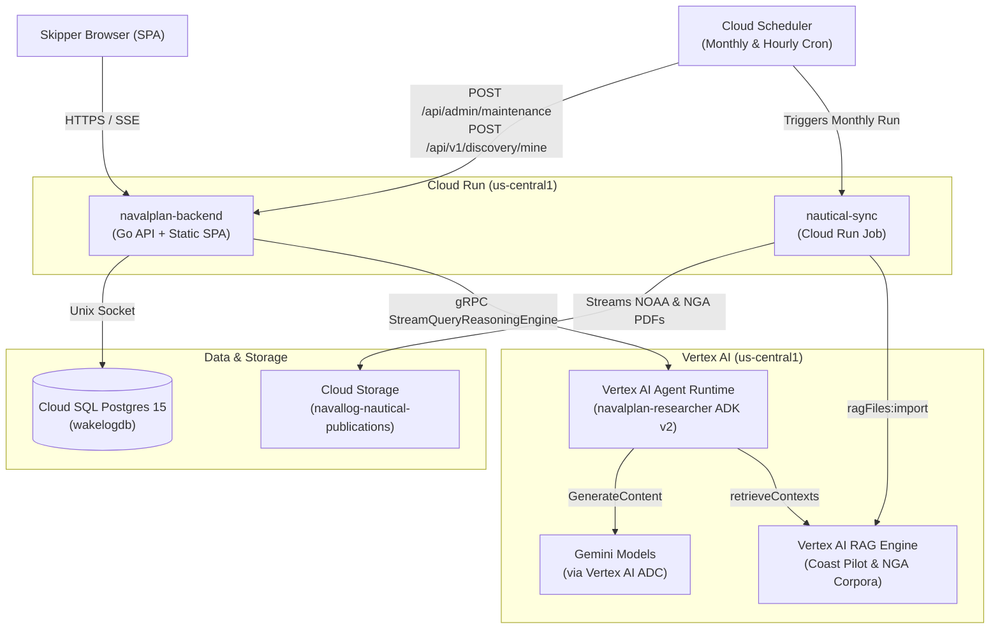

# NavalPlan — Google Cloud Architecture Review & Recommendations

**Date:** October 14, 2026  
**Repository:** [`github.com/tpryan/navalplan`](https://github.com/tpryan/navalplan)  
**GCP Project:** `navallog` (`us-central1`)

---

## Executive Summary

The core application architecture of **NavalPlan** is **clean, pragmatic, and well-suited to its workload**. In live production, the footprint is actually quite lean:
1. **`navalplan-backend` (Cloud Run Service):** Serves both the compiled Vanilla JS/Vite SPA (`static.min`) and the Go REST API.
2. **`navalplan-researcher` (Vertex AI Agent Runtime / Reasoning Engine):** Runs the ADK v2 Go multi-agent system (`projects/70159681032/locations/us-central1/reasoningEngines/1643463669536784384`).
3. **`nautical-sync` (Cloud Run Job):** Monthly batch job triggered by Cloud Scheduler that streams NOAA Coast Pilot and NGA Sailing Directions PDFs to Cloud Storage and imports them into **Vertex AI RAG Engine** corpora.
4. **`wakelogdb` (Cloud SQL for PostgreSQL 15):** Relational persistence accessed via Unix socket.

**Where the "too many sub-bits" feeling comes from:**  
While your **live** GCP environment has moved to Vertex AI Agent Runtime, the **repository (`Makefile`, `.cloudbuild/`, `scripts/`, and Go client code)** still carries the scaffolding from earlier architectural iterations—including a legacy Cloud Run deployment path for the agent, four simultaneous wire protocols on the researcher service, twelve Secret Manager mounts (several of which are non-sensitive config), three database migration mechanisms, and `gcr.io` vs. Artifact Registry drift.

---

## 1. What Is Architected Well (Keep As-Is)

* **Single-Container Frontend + Backend (`navalplan-backend` on Cloud Run):**  
  Compiling `code/app/frontend` into `code/app/backend/static.min` during the build and serving static assets alongside `/api/v1/*` from one Go binary eliminates CORS configuration, separate CDN/hosting buckets, and extra Cloud Run services.
* **Batch RAG Sync via Cloud Run Jobs (`code/jobs/nautical-sync`):**  
  Using `Cloud Scheduler` → `Cloud Run Job` (`nautical-sync`) → `Cloud Storage` → `Vertex AI RAG Engine` (`ragFiles:import`) is the right serverless pattern for long-running PDF downloads and chunking/embedding jobs (`--task-timeout=3600s`).
* **ADK Sub-Agent Tool Isolation (`code/services/researcher/internal/agent/agent.go`):**  
  Wrapping `FindPlacesNearby` + Google Search inside `facility_discovery` and isolating the two Vertex AI RAG corpora (`coast-pilot-corpus`, `nga-sailing-directions-corpus`) inside `hydrographic_pilot` cleanly avoids Gemini's restriction on mixing grounded Google Search with custom function declarations in the same request.
* **Structured Cloud Logging & Cloud Trace (`internal/telemetry`):**  
  Mapping `slog.NewJSONHandler` attributes to `severity`, `logging.googleapis.com/trace`, and `logging.googleapis.com/spanId` alongside OpenTelemetry batch export gives end-to-end trace correlation across the backend and agent runtime.

---

## 2. Priority Recommendations (Simplification & Cleanup)

### Priority 1: Dual Agent Deployment (`Cloud Run` + `Vertex AI Agent Runtime`) — **Decision: Keep Both**

`navalplan-researcher` is deployed to two targets in `.cloudbuild/cloudbuild-agent.yaml`:
1. **Vertex AI Agent Runtime (Reasoning Engine)** (Step 4): Serves `navalplan-backend` via gRPC `StreamQueryReasoningEngine`. All ADK agent tool calls execute in-process inside Reasoning Engine.
2. **Cloud Run (`navalplan-researcher`)** (Steps 1–3): Serves the HTTP `/mcp/tools` (MCP JSON-RPC) and `/invoke/{agent}` (A2A) endpoints registered in **GCP Agent Registry** (`make register-registry`), since Vertex AI Agent Runtime only exposes `:query`/`:streamQuery` rather than custom HTTP paths.

---

### Priority 2: MCP & A2A Wire Protocols in `code/services/researcher` — **Completed**

`code/services/researcher/internal/server/server.go` exposes four protocol surfaces:
1. `/api/*` — Standard ADK REST/SSE server (`adkrest.NewServer`) used by local dev (`make dev`).
2. `/api/reasoning_engine` & `/api/stream_reasoning_engine` — Used by Vertex AI Agent Runtime (`ReasoningEngine`).
3. `/invoke` & `/invoke/{agent}` — **A2A JSON-RPC + Agent Cards** (`adka2a` / `a2asrv`) for Agent Registry.
4. `/mcp/tools` — **MCP JSON-RPC handler** (`internal/mcp/mcp.go`) for Agent Registry.

**Resolution:**
* Added the missing `CalculateHeading` tool to `internal/mcp/mcp.go` (`tools/list` and `handleToolCall`) so all 8 tools in `NauticalToolService.AsTools()` are reusable via MCP.
* Added `TestHandler_AllADKToolsExposedInMCP` in `internal/mcp/mcp_test.go` to enforce 1:1 parity between `NauticalToolService.AsTools()` and `/mcp/tools`.

---

### Priority 3: Secret Manager Configuration — **Decision: Keep All App Config in Secret Manager**

`navalplan-backend` mounts all 12 configuration and secret values from Google Cloud Secret Manager (`scripts/setup_secrets.sh` → `.cloudbuild/cloudbuild.yaml`).

**Decision:** Retained intentionally so all environment-specific configuration lives in one canonical store (`.env` → Secret Manager) rather than splitting values across Secret Manager and hardcoded `.cloudbuild/cloudbuild.yaml` flags.

---

### Priority 4: Vertex AI ADC vs. `GEMINI_API_KEY` in `researcher` — **Completed**

In `code/services/researcher/internal/config/config.go` and `code/services/researcher/internal/agent/agent.go`, the service supports two Gemini authentication modes:
1. **Vertex AI (`GOOGLE_GENAI_USE_VERTEXAI=true`)**: Uses Google Cloud Application Default Credentials (the attached GCP Service Account IAM identity). No `GEMINI_API_KEY` string is required.
2. **Google AI Studio (default when `GOOGLE_GENAI_USE_VERTEXAI` is unset/false)**: Authenticates using `GEMINI_API_KEY`.

**Resolution:**
* Updated `config.New()` (`code/services/researcher/internal/config/config.go`) to parse `UseVertexAI` (`GOOGLE_GENAI_USE_VERTEXAI`) and `GeminiLocation` (`GOOGLE_CLOUD_LOCATION`), only requiring `GEMINI_API_KEY` when `UseVertexAI` is `false`.
* Documented both authentication modes thoroughly in `config.go` and `agent.go` and added unit test coverage (`TestNew_VertexAIModeDoesNotRequireGeminiAPIKey`).

---

### Priority 5: Standardize on One Database Migration Path — **Completed**

**Resolution:**
* Removed `deploy-sql`, `migrate-prod-gcs`, and `db-publish-prod` (`gcloud sql import sql`) from `Makefile`.
* Standardized exclusively on `golang-migrate` (`.cloudbuild/cloudbuild-migrate.yaml` for CI/CD and `make migrate-prod` for operator CLI use).

---

## 3. Infrastructure & Config Drift to Fix

| Item | Location | Issue | Fix |
| :--- | :--- | :--- | :--- |
| **Duplicate `nautical-sync` Cloud Run Job** | Live GCP Console (`Cloud Run Jobs`) | `nautical-sync` is deployed in both `us-central1` and `us-west1` (both updated Aug 31, 2026). | Delete the `us-west1` job: `gcloud run jobs delete nautical-sync --region=us-west1 --project=navallog` |
| **`gcr.io` vs. Artifact Registry** | `.cloudbuild/cloudbuild.yaml`, `.cloudbuild/cloudbuild-nautical-sync.yaml`, `scripts/setup_infra.sh` | `setup_infra.sh` creates Artifact Registry repo `navalplan-repo`, but all Cloud Build configs push to legacy `gcr.io/${PROJECT_ID}/...`. | Update image URLs in `.cloudbuild/*.yaml` to `us-central1-docker.pkg.dev/${PROJECT_ID}/navalplan-repo/...`. |
| **Dead `NAVALPLAN_USE_AGENT_REGISTRY` Flag** | `code/app/backend/internal/config/config.go` (`AgentRegistryEnabled`), `.cloudbuild/cloudbuild.yaml` | `cfg.AgentRegistryEnabled` is parsed from `NAVALPLAN_USE_AGENT_REGISTRY` but is never read anywhere in the codebase (`server.New` hardcodes `resolver = nil`). | Either wire `AgentRegistryEnabled` into `server.New` or remove the env var and struct field. |
| **Redundant `.cloudbuild/cloudbuild-debug.yaml`** | `.cloudbuild/cloudbuild-debug.yaml` | Almost identical to `cloudbuild.yaml` except it skips `go test`, uses older `gcr.io/cloud-builders/npm`, and sets `NAVALPLAN_USE_AGENT_REGISTRY=true`. | Delete `.cloudbuild/cloudbuild-debug.yaml` to avoid maintaining duplicate Cloud Run deploy flags. |
| **Logging Bucket Name Mismatch** | `scripts/setup_infra.sh` vs. `.cloudbuild/*.yaml` | `setup_infra.sh` creates `gs://${PROJECT_ID}-logging`, while `.cloudbuild/*.yaml` hardcodes `logsBucket: gs://navalplan-logging-bucket`. | Align `setup_infra.sh` and `.cloudbuild/*.yaml` on the same bucket name. |
| **Committed SA Key (Resolved)** | `config/navallog-sa.json` | Service account key `ed7e23aa998afcf030d83a7de8ca1e4bacf546c1` was tracked in git. | **Completed:** Removed from `main` (`a2a9bf1`) and revoked in GCP. |

---

## 4. Target Simplified Architecture

After applying the cleanup above, NavalPlan's GCP footprint is minimal, cohesive, and has zero redundant moving parts:



---

## 5. Quick-Win Cleanup Checklist

- [x] Remove `config/navallog-sa.json` from Git and revoke the IAM key (`ed7e23aa998afcf030d83a7de8ca1e4bacf546c1`).
- [ ] Delete the duplicate `us-west1` Cloud Run Job:
  ```bash
  gcloud run jobs delete nautical-sync --region=us-west1 --project=navallog
  ```
- [x] Keep dual deployment (`Cloud Run` + `Vertex AI Agent Runtime`) in `.cloudbuild/cloudbuild-agent.yaml` so Agent Registry MCP (`/mcp/tools`) and A2A (`/invoke/*`) remain live alongside Reasoning Engine.
- [x] Sync `/mcp/tools` (`internal/mcp/mcp.go`) with `NauticalToolService.AsTools()` by adding `CalculateHeading` and a parity unit test.
- [x] Delete `.cloudbuild/cloudbuild-debug.yaml` and align `LOG_BUCKET` in `scripts/setup_infra.sh`.
- [x] Keep all 12 app config/secret values centralized in Secret Manager (`scripts/setup_secrets.sh`).
- [x] Remove `deploy-sql`, `migrate-prod-gcs`, and `db-publish-prod` from `Makefile` and standardize on `golang-migrate` (`.cloudbuild/cloudbuild-migrate.yaml` / `make migrate-prod`).
- [x] Make `GEMINI_API_KEY` optional in `code/services/researcher/internal/config/config.go` when `GOOGLE_GENAI_USE_VERTEXAI=true`, and document both Gemini auth modes in `config.go` and `agent.go`.
